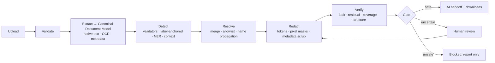

# ClearGate

**A privacy gate between business documents and AI models.**
ClearGate extracts text from PDFs (including scans), Word and PowerPoint files, detects and classifies personal data, redacts it with consistent tokens, verifies the result independently, and lets a document through to the AI only when it can show the document is safe.

Built for the **Optiv Consulting case study PS-2: Text Analysis and PII Detection** (client scenario: Cadence Financial Group).

> **Status: Phase 3 (extraction) complete.** Validation, PDF/DOCX/PPTX/image extraction with OCR, face and unreadable-region detection, the pipeline, the CLI and the privacy gate exist and are tested on synthetic fixtures and the real samples. Detection, redaction and verification are not built yet, so every file still ends `BLOCKED`. The [status table](#status) is the source of truth for what exists, and nothing here should be read as "it works" until that table says *Verified*. The commands under [Quick start](#quick-start-planned) are the target interface. Progress: [docs/PROGRESS.md](docs/PROGRESS.md); test traceability: [docs/VERIFICATION.md](docs/VERIFICATION.md).

[PRD](docs/PRD.md) · [Architecture & technical decisions](docs/Architecture.md) · [TRD](docs/TRD.md)

---

## Why ClearGate exists

Cadence policy forbids personal data from reaching AI models, but the documents employees analyse are full of it: names, emails, phones, employee IDs, SSNs, PANs, passport numbers, dates of birth, home addresses. It shows up in tables, narrative prose, screenshots, photos and file metadata.

The real PS-2 sample set shows why simple tools fail:

- The risk-policy **PDF is entirely scanned**: 35 pages, zero extractable text. A text-only extractor reports "0 PII found" and passes everything downstream.
- Identifiers sit **inside photographed forms and screenshots**. OCR damages some of them, and one screenshot is illegible even at 600 DPI.
- **People and vendors share sentences and table cells.** Off-the-shelf NER merged three names into one span and labelled a SaaS product as a place.
- The PowerPoint's mobile numbers use a format a **standard phone library rejects**.

ClearGate is designed around those facts. See [Architecture §2](docs/Architecture.md#2-what-the-sample-files-taught-us-design-drivers) for the full findings.

## What makes it different

| | |
|---|---|
| **Fail-closed privacy gate** | Explicit, code-enforced states: `PROCESSING → REVIEW_REQUIRED · BLOCKED · VALIDATED_SAFE · FAILED`. Only `VALIDATED_SAFE` mints the signed handle the AI handoff accepts. An unread page, an unapplied redaction or a surviving value blocks the document. |
| **Context-aware detection** | Five layers: validators → label-anchored capture (catches OCR-damaged IDs after `SSN`, `PAN`, `DOB`) → NER on pre-split segments → field-label, honorific and initial rules → document-wide name propagation. A vendor/product allowlist can suppress *only* NER guesses, never validated identifiers. |
| **Evidence traceability** | Every finding records where it is (page + box, slide + shape, table row/column, XML part, image), which detectors fired, and why. |
| **Independent verification** | The output file is re-opened through a different path, scanned for every original value and its variants, re-scanned for residual PII, and checked for coverage and structure. |
| **Format-native processing** | Scans are OCR'd and redacted *in pixels*. Word and PowerPoint are edited in place, keeping styles, tables and layout. Metadata is scrubbed. No visual overlays. |
| **Consistent pseudonyms** | `[PERSON_7]` means the same person across every file in a batch. The mapping sits in an encrypted vault that never leaves the service. |
| **Human review** | Uncertain findings and illegible regions go to a reviewer with full evidence. After decisions, the system re-verifies before the gate decides again. |
| **Measured, not claimed** | Labelled gold set, per-type precision/recall, **leak rate** as the headline metric, and small-sample caveats stated in the report. |

## How it works



Example:

```
Original : Rahul Sharma from Finance can be contacted at rahul@example.com.
Sanitized: [PERSON_1] from Finance can be contacted at [EMAIL_1].
```

## Status

| Capability | Designed | Implemented | Verified |
|---|:-:|:-:|:-:|
| Sample-file structure analysis (PDF/DOCX/PPTX profiling, OCR timing, NER probes) | Yes | Yes (one-off scripts) | Yes (findings in Architecture §2) |
| Project bootstrap: policy config + hash, CDM models (raw fields never serialise), typed errors, PII-safe logging, doctor | Yes | Yes | Yes ([Phase 0](docs/phases/PHASE-00-bootstrap.md)) |
| File validation & batch ingestion (CLI) | Yes | Yes | Yes ([Phase 2](docs/phases/PHASE-02-skeleton.md)) |
| Canonical Document Model + PDF/DOCX/PPTX/image extractors with OCR, faces, regions | Yes | Yes | Yes ([Phase 3](docs/phases/PHASE-03-extract.md)) |
| Layered detection (L1–L5) + allowlist + evidence tiers | Yes | No | No |
| Token redaction + encrypted vault | Yes | No | No |
| Format-native writers (scanned PDF, native PDF, DOCX, PPTX, images) | Yes | No | No |
| Independent verification (V1–V6) | Yes | No | No |
| Privacy gate state machine + rules G0..G7 + SafeHandle | Yes | Yes | Yes ([Phase 1](docs/phases/PHASE-01-gate.md)) |
| Mock AI handoff | Yes | No | No |
| Review queue + Streamlit UI | Yes | No | No |
| Reports + audit trail | Yes | No | No |
| Evaluation harness + gold set | Yes | No | No |
| `REFERENCE_GAP_ANALYSIS.md` | partial (summary in Architecture §3) | No | No |
| XLSX, legacy `.doc/.ppt` | stretch | No | No |

## Supported formats (v1 target)

| Format | Extraction | Redacted output |
|---|---|---|
| PDF, scanned | OCR (Tesseract 5, 300 DPI) with word boxes and confidence | Same page count and geometry, PII burned into pixels, metadata cleared |
| PDF, native | PyMuPDF text + boxes; OCR for embedded images | True content redaction (`apply_redactions`), metadata cleared |
| DOCX | Ordered walk of body, tables, text boxes, headers/footers, notes, alt text, metadata; OCR of embedded images | Original package edited in place; redacted images swapped in; metadata scrubbed |
| PPTX | Shapes, groups, tables, notes, metadata; OCR of pictures | Edited in place; native text stays text |
| PNG/JPG/TIFF | OCR + face detection | Pixel-redacted copy, EXIF stripped |

Rejected with a clear message: `.doc`, `.ppt`, macro-enabled files, encrypted files, oversized or malformed archives.

## Quick start (planned)

**Prerequisites:** Python 3.12+, Tesseract 5 with English data, ~2 GB disk for the spaCy model. No GPU, no paid APIs.

```bash
# 1. Install
git clone <private-repo-url> cleargate && cd cleargate     # private repo only (see Confidentiality)
python -m venv .venv && source .venv/bin/activate
pip install -e ".[dev]"
python -m spacy download en_core_web_lg
tesseract --version                                        # expect 5.x

# 2. Secrets (never commit)
export CLEARGATE_VAULT_KEY=$(python -c "from cryptography.fernet import Fernet;print(Fernet.generate_key().decode())")
export CLEARGATE_GATE_KEY=$(python -c "import secrets;print(secrets.token_urlsafe(32))")
export CLEARGATE_SUBMITTER_TOKEN=... CLEARGATE_REVIEWER_TOKEN=...

# 3. Run
uvicorn cleargate.api.main:app --port 8000          # API + background workers
streamlit run cleargate/ui/app.py                   # UI on :8501
# or: docker compose up
```

### CLI

```bash
cleargate process samples/*.pptx samples/*.docx samples/*.pdf --policy config/policy.default.yaml --out out/
cleargate status <batch_id>
cleargate eval --gold eval/gold --out eval/report.md
```

### API

```bash
# Submit a batch
curl -H "Authorization: Bearer $CLEARGATE_SUBMITTER_TOKEN" \
     -F files=@Cadence_Financial_Group_Organizational_Pack.pptx \
     -F files=@Cadence_TPRM_Training.docx \
     http://localhost:8000/api/v1/batches

# Poll a job
curl -H "Authorization: Bearer $CLEARGATE_SUBMITTER_TOKEN" http://localhost:8000/api/v1/jobs/<job_id>

# Download sanitized text: returns 403 unless the job is VALIDATED_SAFE
curl -H "Authorization: Bearer $CLEARGATE_SUBMITTER_TOKEN" \
     http://localhost:8000/api/v1/jobs/<job_id>/artifacts/sanitized.txt

# Hand off to the (mock) AI agent: 409 unless VALIDATED_SAFE
curl -X POST -H "Authorization: Bearer $CLEARGATE_SUBMITTER_TOKEN" \
     http://localhost:8000/api/v1/jobs/<job_id>/handoff
```

Full endpoint list: [TRD §10](docs/TRD.md#10-api-fastapi-apiv1).

## Configuration

A YAML policy controls what counts as PII, what is kept for context, the vendor/product allowlist, thresholds and OCR settings. Excerpt:

```yaml
entities:
  enabled: [PERSON, EMAIL_ADDRESS, PHONE_NUMBER, EMPLOYEE_ID, US_SSN, IN_PAN, PL_PESEL,
            PASSPORT, TAX_ID, DATE_OF_BIRTH, HOME_ADDRESS, FINANCIAL_PARTIAL, PAYMENT_CARD, PHOTO]
keep: {organisations: true, role_titles: true, corporate_addresses: true, non_dob_dates: true}
allowlist:
  products: [OneTrust, Ironclad, Torii]
ocr: {dpi: 300, unreadable_policy: mask_and_review}
llm: {enabled: false}
```

Full schema: [TRD §11](docs/TRD.md#11-configuration-configpolicydefaultyaml). Each policy is hashed, and the hash appears on every job and report.

| Environment variable | Purpose |
|---|---|
| `CLEARGATE_VAULT_KEY` | Fernet key for the pseudonym vault (required) |
| `CLEARGATE_GATE_KEY` | HMAC key that signs SafeHandles (required) |
| `CLEARGATE_SUBMITTER_TOKEN`, `CLEARGATE_REVIEWER_TOKEN` | Prototype bearer tokens |
| `CLEARGATE_DATA_DIR` | Job storage (default `./data`, created `0700`) |

## What you get per document

- **Sanitized text**: reading-order text with structure markers (`[Page 18]`, headings, table rows) and tokens. This is the only thing the AI sees.
- **Redacted file**: same format, same page/slide count.
- **Processing report** (JSON + Markdown): file and type, final state with the rule that decided it, PII counts by type, a location for each finding (masked preview only), redaction actions, verification results, unresolved items, OCR pages, timings, warnings, policy hash.

Downloads of sanitized text and redacted files are **only** available in `VALIDATED_SAFE`. Reports are available in every state and never contain raw values.

## Project layout

```
cleargate/   core · ingest · extract · detect · redact · verify · gate · report · api · ui · pipeline.py
config/      policy.default.yaml
eval/        gold/ (private) · fixtures/ · run_eval.py · metrics.py
tests/       unit/ · integration/ · security/
scripts/     doctor · genkeys · check_matrix · check_style · smoke
docs/        PRD.md · TRD.md · Architecture.md · DECISIONS.md · VERIFICATION.md · PROGRESS.md · phases/
```

## Testing and evaluation

```bash
pytest                       # unit + integration + security (socket-blocked, log-leak grep, fault injection)
cleargate eval               # metrics vs PS-2 targets → eval/report.md
```

Key tests include: **OCR disabled → scanned PDF must end `BLOCKED`**; a forced unapplied redaction must end `BLOCKED`; a tampered SafeHandle must be refused; no gold PII value may appear in any output part, log or report.

## Limitations (known, by design or by scope)

- **No scanner proves zero PII.** ClearGate combines detection, verification, coverage and human review, and reports measured leak rate and recall. It does not claim a guarantee.
- **The evaluation set is tiny** (three real documents plus synthetic fixtures). Reported numbers come with intervals and are not generalisable.
- **OCR has a ceiling.** Illegible regions are masked and sent to review, so some context is lost.
- **Quasi-identifiers stay by default.** Role titles and organisation context are kept for the AI and can still single someone out (e.g., "Group CRO"). `role_title_policy: generalize` is available.
- **Organisation and client names are not redacted** (not PII under PS-2). Logo/client-name anonymisation is future work.
- **Scanned-PDF processing is slow on small machines.** OCR measured at ~14 s/page on 2 vCPU, and verification re-OCRs the output.
- **Prototype security:** static bearer tokens, single tenant, SQLite metadata (no raw PII), OS-permission protection for uploads, and a mock AI client by default. Not production-grade access control or encryption at rest.
- **English-only NER.** Non-Latin names and non-English documents are untested.

## Confidentiality

The case-study files are confidential teaching artifacts. Per the brief: no public repository, no published presentation, no contact with the named organisations. Keep `samples/` and `eval/gold/` out of version control (`.gitignore`), and never paste sample content into external tools, including AI assistants that are not ClearGate's local mock.

## Acknowledgements

Design lessons were drawn from the documentation of an earlier project, Smart-Redact (the summary is in [Architecture §3](docs/Architecture.md#3-lessons-from-the-smart-redact-reference)). ClearGate is an independent design: different architecture, workflow, verification model and user experience.
