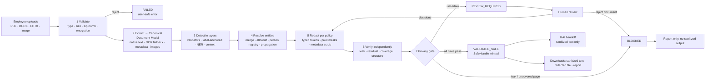
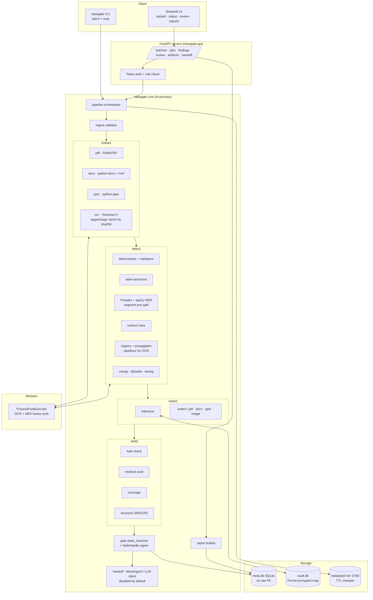
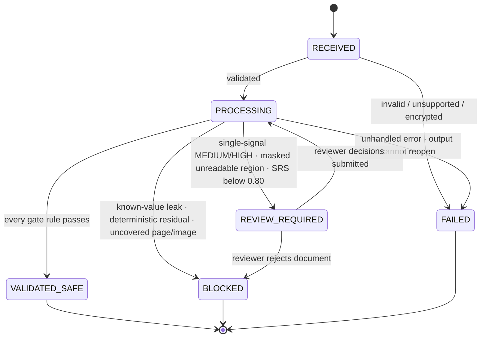

# ClearGate: Architecture & Technical Decisions

> Companion documents: [README](../README.md) · [PRD](PRD.md) · [TRD](TRD.md)
> Scope: Optiv Consulting case study PS-2 (Case Study 2, Text Analysis and PII Detection, Cadence Financial Group).
> Status: **design baseline v0.1, no code yet.** Every "observed" or "measured" statement below comes from profiling the real PS-2 sample files on 13 Oct 2026. Every "will" statement is a design commitment, not a claim that it works.

---

## 1. The one-paragraph architecture

ClearGate is a **privacy enforcement layer between document ingestion and an AI model**. It is not a set of per-format redaction scripts. Each file goes through one pipeline: **validate → extract into a Canonical Document Model → detect in layers → resolve entities → redact → verify independently → gate**. Only the gate can mint the handle that the AI handoff accepts, and it **fails closed**: if a page was not inspected, an image could not be read, or a known value survives redaction, the document does not become `VALIDATED_SAFE`. It runs as a single modular Python application (FastAPI service, background worker pool, SQLite metadata, encrypted pseudonym vault, Streamlit review UI). It runs locally and makes no external calls by default.

---

## 2. What the sample files taught us (design drivers)

The design is driven by what is actually in the three PS-2 artifacts, not by a generic PII checklist.

| # | Observation (verified on the real files) | Consequence for the design |
|---|---|---|
| D1 | `Cadence_Group_Risk_Management_Policy__v6.0.pdf` has **35 pages, 0 native text characters, 1 full-page image per page**. It is a scanned document. | OCR is mandatory. A pipeline that extracts only native PDF text sees an empty document, finds 0 PII and reports success. ClearGate treats "no text extracted from a page that has pixels" as an **uninspected page**, which blocks the gate. |
| D2 | Tesseract 5.3.4 at 300 DPI: mean word confidence per page was **79.1–95.7**. The lowest page (p.32) is a clean RACI matrix whose single-letter cells pull the mean down. | Page-level mean confidence is a poor quality signal. Gate rules use **per-word confidence inside candidate PII spans** and **per-region** confidence. |
| D3 | OCR of the 35-page PDF took **8 min 12 s wall time** (2 worker processes, 2 vCPU container), about 14 s per page. | OCR runs in a **background worker** with per-page progress. The UI never blocks. Results are cached by page-image hash. |
| D4 | Figure 8 (p.18) is a photographed form *inside* the scan. OCR turned identifiers into invalid forms (an SSN with a dropped digit, a risk ID garbled into a mixed-case token, an Indian PAN with `T` substituted for `7`). | Strict format regexes miss these. ClearGate adds **label-anchored capture** (redact the value after `SSN`, `PAN`, `Passport`, `DOB` whatever its format), **OCR-confusion-tolerant matching** and **low-confidence region masking**. |
| D5 | Figure 3 (p.9) is a screenshot of an identity record with a **face photograph** and text that stays illegible even at 600 DPI with 2× upscaling (only a misspelled name survived). | Some regions **cannot be cleared by scanning at all**. Policy: mask the whole region and route the document to review. Never mark such a region as "no PII found". |
| D6 | §16.5 and §16.8 of the PDF contain **unlabelled narrative PII**: names, employee IDs, DOB, SSN, passport, PAN, home address, spouse's name, card/account "ending NNNN", SSN last-four. The document's own exercise prompts call this "the hardest artifact class". | Field-label extraction alone fails here. NER, contextual rules for partial identifiers ("ending NNNN", "last four digits ... (NNNN)") and honorific rules are required. |
| D7 | `Cadence_TPRM_Training.docx`: 402 paragraphs, 16 tables, 35 inline images (~30 UI screenshots), 4 text boxes, headers/footers, 56 auto-generated alt-text attributes. **No email or phone in native text.** Personal names appear in **table cells as `/`-separated lists** and **only inside screenshots**. | DOCX extraction must walk the body **in document order**, including tables, SDT blocks, text boxes, headers/footers, alt text and core properties, and **OCR every embedded image**. |
| D8 | spaCy `en_core_web_sm` 3.8.0 on DOCX/PDF-style strings: merged three `/`-separated names into **one** PERSON span. Missed a name made of two ordinary English words in a screenshot table. Missed `Ms <Hyphenated-Surname>` and `Led by <Name>`. Tagged the SaaS product **"Torii" as GPE**. Tagged "DOB"/"SSN" as ORG and a 4-digit account suffix as DATE. | Off-the-shelf NER is necessary but not sufficient. ClearGate adds **segment splitting before NER**, **column-header and field-label context**, **honorific/initial patterns**, **document-level name propagation**, and a **business-entity allowlist** that can only suppress NER findings. This is our answer to the interview question "documents contain many names and vendors, how do you separate people from proper nouns?" |
| D9 | `Cadence_Financial_Group_Organizational_Pack.pptx`: 9 slides, all native text, 3 tables, a 16-person directory. Mobiles are written `+1 (555) 01NN`. `phonenumbers` 9.0.41 (the library behind Presidio's phone recognizer) **matched none of them** and also missed a Polish mobile with irregular digit grouping, while matching the PDF's well-formed numbers. | Add a **label-anchored phone recognizer** (`M`, `Mobile`, `Direct line`, column header `Mobile`) next to the library recognizer. PPTX gets **native, in-place redaction**; rasterising slides would throw away perfectly good native text. |
| D10 | The same person appears in different forms: `Priya Halvorsen`, `P. Halvorsen` (RACI header), `p.halvorsen@...` (email). Some names appear in all three files (with a different role in each). The PDF's exercise prompts ask for "cross-artifact traceability of individuals via stable tokens". | **Entity resolution** across forms and across a batch. One person gets one pseudonym token (`[PERSON_7]`) everywhere in a batch. The mapping lives in an **encrypted vault** that never leaves the service. |
| D11 | **Personal names sit in file metadata.** The PDF Info `Author` and the DOCX/PPTX `creator`/`lastModifiedBy` fields hold people's names. | Metadata is extracted as segments, scanned, and **scrubbed** in outputs. |
| D12 | In the DOCX screenshots, the original tenant name and logo of a real organisation are still visible underneath pasted-on "Cadence" labels. | A live example of overlay anonymisation leaking the original. ClearGate never relies on overlays: redaction is **burned into pixels** or **removed from content streams**. (Organisation names are not PII under PS-2. The case is noted under §9 as a client-confidentiality risk.) |
| D13 | Presidio 2.2.364: `SpacyRecognizer` gives **every** NER hit a fixed score of 0.85. `PhoneRecognizer` scores 0.4. The SSN recognizer rejects only 000/666 area numbers, so the sample's 900-series SSNs are accepted. | Raw scores are not calibrated probabilities. ClearGate turns detector outputs into **evidence tiers** (§4.4) and calibrates thresholds on the labelled set. It does not trust a single number. |

---

## 3. Lessons from the Smart-Redact reference

Only the Smart-Redact **documentation** was available, not its source code. Everything below is therefore "documented, not verified". The full feature-by-feature table belongs in `REFERENCE_GAP_ANALYSIS.md`. These are the decisions that changed because of it:

| Smart-Redact (as documented) | Problem for PS-2 | ClearGate decision |
|---|---|---|
| PDF text via `pypdfium2` only, no OCR on the PDF path | Fails open on our scanned PDF (D1): empty text → 0 findings → `completed` | OCR fallback per page, plus the **coverage check** in verification. An uninspected page blocks the gate. |
| Redacted PDF rebuilt from plain text with ReportLab | Destroys layout, tables and figures, so the ≥ 80 % structure target is unachievable | Keep the original page geometry. Burn masks into the page raster (scanned) or apply true content-stream redaction (native). |
| Redaction via `str.replace(entity_text, …)` over the whole text | Ignores offsets. Replaces substrings inside other words. Misses variants. | **Offset-based** redaction against located segments. Variants are handled by entity resolution. |
| Verification = case-insensitive substring search for found values | Only proves found values were replaced. Says nothing about missed PII or format variants. | **Independent verification** on re-extracted output: normalised leak check, residual scan with a different detector configuration, structure and coverage checks. |
| spaCy `ORG`, `GPE`, `DATE`, `MONEY` mapped to PII, fixed confidence 0.8 | Over-redacts vendors, cities and every date. Destroys the business context the AI needs. | PII taxonomy limited to personal data (§4.2). ORG/vendor names are kept. Dates are redacted only as DOB. |
| PPTX → LibreOffice → PDF → PNG → OCR → image-only deck | Replaces native text with pictures. OCR errors on clean text. The AI can't read the output without re-OCR. | Native `python-pptx` extraction and **in-place run-level redaction**. OCR only for embedded pictures. |
| DOCX: paragraphs, then all tables appended; rebuilt with `Document()` | Loses reading order, styles, headers/footers, text boxes, images, metadata | Ordered body walk over all XML parts. **In-place** edit of the original package. |
| "99 %+ precision", "98 %+ accuracy" stated without an evaluation set | Unverifiable claims | Labelled gold set, per-type precision/recall, **leak rate** as the headline metric, and small-sample limitations stated. |
| Image redaction doc says phases "Completed", footer says "In Progress / Pending testing" | Status ambiguity | Every capability carries an explicit status (Planned / Implemented / Verified) in the README. |
| No processing states, review, or AI-gate semantics | Nothing stops unsafe content reaching the model | Enforced state machine, a review queue and a handoff that requires a gate-minted handle. |

Ideas we **keep** from the reference: local-only processing, FastAPI, Tesseract word boxes for image coordinates, Presidio + spaCy as a base layer, merging nearby image regions, and "original files never modified" (we work on copies).

---

## 4. Technical decisions (ADR log)

Each decision records context, the choice, the alternatives considered, and the consequences. IDs are stable so the TRD and code can cite them.

### ADR-01: Modular monolith, not microservices
- **Context:** A 3-week student build. The bottleneck is CPU-bound OCR, not request fan-out.
- **Decision:** One Python package (`cleargate`) with strict module boundaries (§5.2). It is deployed as one FastAPI process plus a `ProcessPoolExecutor` worker pool. The Streamlit UI is a thin client of the API.
- **Rejected:** Celery + Redis, separate OCR/NER services, Kubernetes. They add operational surface and no PS-2 value.
- **Consequences:** Horizontal scale means more worker processes or more hosts behind the same API. Module interfaces are written so a stage could later move to a queue worker without code changes in other stages.

### ADR-02: Canonical Document Model (CDM) as the single contract between stages
- **Context:** Detection, redaction, verification and reporting must not be rewritten per format.
- **Decision:** Every extractor emits `Document → Segment[]`. A segment is the smallest addressable text unit (paragraph, table cell, shape paragraph, OCR line, metadata field, alt text). Each segment carries a typed `Locator` (page/bbox, slide/shape, table/row/col, XML part, image ref) and extraction provenance (native vs OCR, word confidences, DPI). Findings point to `(segment_id, start, end)`. Writers map them back to the source through the locator.
- **Consequences:** Traceability comes for free: every finding has a source location. The structure-retention metric is computed on CDM units. Adding a format means writing an extractor and a writer, nothing else.

### ADR-03: Extraction strategy per format; native first, OCR as fallback and for images
| Format | Primary | OCR used for | Not used, and why |
|---|---|---|---|
| PDF | PyMuPDF text with spans/bboxes | Any page whose native text < `min_native_chars` (default 25) **or** whose image coverage > 60 %, and every embedded image > `min_image_px` on native pages | `pypdf`-only (no layout), ReportLab rebuild (layout loss) |
| DOCX | `python-docx` plus direct `lxml` walk of `document.xml`, headers, footers, footnotes, endnotes, comments, text boxes, SDT, `docProps/*` | Every image in `word/media` that is referenced from the body | Rebuilding with `Document()` |
| PPTX | `python-pptx`, recursive over groups, tables cell by cell, notes, `docProps/*` | Every picture shape larger than an icon threshold. The per-slide logo is hashed once and cached | LibreOffice rasterisation (ADR rejects it; see §3) |
| PNG/JPG/TIFF | - | Whole image | - |

- OCR engine: **Tesseract 5** via `pytesseract.image_to_data` (word boxes, block/line ids, confidences). 300 DPI for scanned PDF pages. Embedded images are OCR'd at native resolution, upscaled 2× when shorter than 1000 px.
- **Rejected:** cloud OCR, which sends content off-host and breaks the local-only requirement. PaddleOCR/EasyOCR: heavier install, no evidence yet that they would fix D4/D5. Kept as a stretch comparison in the evaluation.

### ADR-04: Layered detection with evidence tiers
Five layers run on every segment. Their outputs are merged, never simply unioned.

1. **L1 Deterministic recognizers with validators**: email; phone (`phonenumbers`, **plus** label-anchored for invalid-but-labelled numbers, see D9); US SSN; Indian PAN (format + 4th-character holder type, `P` = individual); Polish PESEL (checksum, **and** partially masked `NNNNNNxxxxx` because the first six digits encode the date of birth); passport (context-required); payment card (Luhn); employee/director/vendor-staff IDs (`EMP-\d{5}`, `DIR-\d{4}`, `[A-Z]{3}-[A-Z]{2}-\d{4}`), configurable per client.
2. **L2 Label-anchored capture**: when a high-risk label (`SSN`, `PAN`, `Passport`, `PESEL`, `DOB`, `Date of birth`, `home address`, `NI`, `TIN`) precedes a value within N tokens, capture the value **whatever its format**. This handles OCR damage (D4). The finding is tagged `format_invalid=true` for the report.
3. **L3 Statistical NER**: Presidio `AnalyzerEngine` with spaCy `en_core_web_lg` (PERSON, plus LOCATION used only to build address spans). Input is **pre-split** on cell boundaries and list delimiters (`/`, `;`, `|`, line breaks) so that one cell of four names yields four spans (D8).
4. **L4 Context rules**: column headers and field labels (`Name`, `Users`, `Created by`, `Led by`, `Attested by`, `Author`, `Owner`, `Chair`, `Contact`); honorifics (`Mr/Ms/Mrs/Dr` + capitalised token(s), hyphen-aware); initial + surname (`P. Halvorsen`, `R. J. Thornfield`); "card/account ending NNNN"; "last four digits … (NNNN)"; US street address + ZIP; "home address" / "home at".
5. **L5 Document- and batch-level propagation (entity resolution)**: every PERSON accepted with tier ≥ CORROBORATED goes into a **person registry**, which generates variants (full, first+last, initial(s)+last, `Last, F.`, honorific+last, email local part). A sweep over **all** segments finds missed mentions such as `Led by <Name>` (D8). In OCR segments the sweep uses fuzzy matching (`rapidfuzz` ratio ≥ 90) to catch OCR-mangled names and emails. Surname-only matches are allowed only for registry-unique surnames that are not common words, and enter as `SINGLE_SIGNAL` (review band).

**Business-entity allowlist (the vendor problem).** The allowlist comes from config (client, vendors, products, e.g. `Cadence`, `Optiv`, `OneTrust`, `Ironclad`, `Torii`, `Halloran & Pike LLP`). It is extended per document with ORG entities that carry a corporate suffix (`Inc`, `LLP`, `Ltd`, `GmbH`, `SA`, `Pte`) or sit in vendor context (`integration with`, `vendor`, `provider`). It **can only suppress NER-only findings** (L3) whose span equals an allowlisted term. It **never suppresses** L1/L2 findings, or a span that is also in the person registry. This is how `Torii` stays as business context while the people in the same paragraph are still redacted.

**Evidence tiers** replace raw scores as the decision unit:

| Tier | Meaning | Default action |
|---|---|---|
| `DETERMINISTIC` | L1 match whose validator passed, or L2 label-anchored capture | Auto-redact |
| `CORROBORATED` | ≥ 2 independent signals agree (e.g., NER PERSON + column header `Users`; or NER + registry) | Auto-redact |
| `SINGLE_SIGNAL` | One non-deterministic signal (NER alone, surname sweep, fuzzy OCR match) | Redact **and** send to review if risk ≥ MEDIUM |
| `LOW` | Below `review_threshold` after calibration | Discard, but count in the report ("n weak candidates not redacted") |

- **Rejected:** a single weighted score with one threshold. Presidio's NER score is a constant (D13), so a threshold on it is meaningless. Custom model training is rejected for now: there is no labelled corpus and a 3-week budget. It is listed as future work.

### ADR-05: PII taxonomy and redaction policy are configuration, versioned with every job
- Personal data in scope (matching the PDF's own definition and the PS-2 brief): person names (employees, directors, vendor staff, customers, relatives), personal and **person-attributable corporate** email, phone numbers, employee/director/vendor-staff IDs, government IDs (SSN, PAN, PESEL, passport, TIN), date of birth, home address, partial financial identifiers, photographs of people, and person names in metadata.
- **Kept by default** to preserve the business context the downstream AI needs: organisation/vendor/product names, role titles, corporate office addresses, cities and countries, non-DOB dates, monetary amounts, policy/risk/issue IDs (`RSK-`, `INC-`, `GRP-POL-`).
- The policy file is hashed, and the hash is stored on every job. A report is only meaningful together with the policy version it ran under.
- Known residual risk: role title + organisation can be a **quasi-identifier** (there is one Group CRO). `role_title_policy: keep | generalize` exists. The default is `keep`, and this is called out in the README limitations.

### ADR-06: Pseudonymous tokens with a separate encrypted vault
- **Output form:** `[PERSON_7] from Finance can be contacted at [EMAIL_12].` Tokens are typed and numbered per **batch**, so the same person gets the same token across all three artifacts (D10) and the AI can still reason about "who did what".
- **Vault:** mapping `HMAC-SHA256(key, normalised_value) → token`, plus the encrypted original (Fernet). It is stored in `vault.db`, separate from metadata, with the key from `CLEARGATE_VAULT_KEY`. The vault is **never** included in reports, logs, downloads or the AI handoff. Batch vaults are deleted with the batch (TTL).
- **Rejected:** fake-but-realistic substitute names (Faker). The AI can't tell them apart from real names, a substitute can collide with a real person, and a residual scanner can't tell substitutes from leaks. Typed tokens are unambiguous and machine-verifiable.

### ADR-07: Redaction modifies the original package in place (copy), never through overlays
| Format | Method | Guarantees |
|---|---|---|
| Scanned PDF / images | Rasterise the page, **burn filled rectangles into pixels** at OCR word boxes (+padding), mask whole low-confidence/face regions, rebuild the PDF from the redacted rasters. Optional invisible text layer containing **sanitized** text only. Original image XObjects are not carried over. | Page count and geometry kept. Original pixels are gone, not covered. |
| Native PDF | PyMuPDF `add_redact_annot` + `apply_redactions(images=PDF_REDACT_IMAGE_PIXELS)`, then scrub the metadata and XMP | Text removed from content streams |
| DOCX / PPTX | Run-level text replacement in the original XML (spans that cross runs are merged into the first run). Images with findings are replaced in `media/` by their redacted rasters. Alt text and `docProps` scrubbed. | Styles, numbering, tables, layout kept |
| Sanitized text | Rendered from the CDM in reading order with structural markers (`# heading`, table rows, `[Slide 3]`, `[Page 18]`) | The artifact that is sent to the AI |

### ADR-08: Verification is independent of detection
Verification re-opens **the output file** through a **separate extraction path** (DOCX/PPTX: raw XML text of *every* part including `docProps`; PDF: PyMuPDF text **and** OCR of the output rasters). It then runs four checks:

1. **Known-value leak check.** Every original finding value and its normalised variants (case-folded, whitespace-collapsed, digits-only, email local part, name variants from the registry) must be absent from all output text. *Blocking.*
2. **Residual scan.** The detector runs in high-recall mode (`review_threshold` lowered, propagation on, allowlist off) over the output. New DETERMINISTIC hits are *blocking*. Other hits trigger *review*.
3. **Coverage.** Every page, slide, image and XML part is either inspected (text extracted with acceptable confidence) or masked. Anything else is *blocking*.
4. **Integrity and structure.** The file reopens, page/slide counts are equal, and the structure retention score (SRS) and context retention score (CRS) are computed (definitions in TRD §9). Reopen failure means `FAILED`. SRS < 0.80 means *review* (it is a quality target, not a privacy failure).

Residual scanning cannot prove zero PII. It is one signal combined with the original findings, coverage and human review. The README states this plainly.

### ADR-09: The privacy gate is an enforced state machine (fail-closed)
```
RECEIVED → PROCESSING → { FAILED | BLOCKED | REVIEW_REQUIRED | VALIDATED_SAFE }
REVIEW_REQUIRED → PROCESSING (re-redact + re-verify after decisions) | BLOCKED (reviewer rejects)
VALIDATED_SAFE  → (terminal for this policy version; a policy change → new job)
```
- Transitions go through one function, `gate.transition(job, to_state, reason)`. It checks a whitelist table and writes an append-only `state_history` row. Illegal transitions raise an error. SQLite has a `CHECK` constraint on `state` values, and a trigger rejects any update that is not mirrored in history.
- **Default deny:** a job reaches `VALIDATED_SAFE` only if *every* rule in TRD §8.2 passes. Any exception inside PROCESSING leads to `FAILED`, never to a partial `SAFE`.
- **Handoff:** `AIHandoff.send(handle)` accepts only a `SafeHandle` minted by the gate: `job_id`, `sha256(sanitized_text)`, `policy_hash`, `verification_report_hash`, signed with HMAC. The handoff re-reads the sanitized text and re-checks the hash, so content can't be swapped after validation. The default AI client is a local mock that summarises. A real LLM client is behind `llm.enabled: false`, and original text or vault data have no code path to it.
- **Rejected:** dashboard-only status labels, which is exactly what the problem statement warns against.

### ADR-10: Human review is part of the pipeline, not an afterthought
- The review queue holds SINGLE_SIGNAL findings of MEDIUM/HIGH risk, masked unreadable regions, residual non-deterministic hits, and SRS < 0.80.
- For each item the reviewer sees the segment text with the span highlighted, type, location, detectors, evidence, tier and proposed token. Actions: **confirm**, **reject** (keep text, justification required), **change type**, or **add missed span**. HIGH-risk DETERMINISTIC findings cannot be rejected in the prototype.
- Decisions are stored as overrides, and the job goes back to PROCESSING for **redaction + verification only**. The gate decides again. A reviewer can't "click safe".
- Rejections are stored in a hashed suppression list per batch. Added spans become propagation seeds. Over time both feed calibration (future).

### ADR-11: Storage, logging and data lifecycle
- **SQLite** (`meta.db`) holds jobs, segments' locators (no text), findings as `(type, tier, locator, value_hmac, masked_preview)`, state history and reports. **No raw PII is stored in metadata.**
- **Files** live in `data/jobs/<job_id>/` with mode `0700`: original copy, CDM cache, outputs. A TTL sweeper deletes them (default 24 h). Temp files are created in the job directory, never in shared `/tmp`.
- **Logging** goes through a structured logger with a `PiiSafeFilter`. Messages may contain only IDs, counts, types and hashes. Exceptions are re-raised as typed errors whose messages contain no document content. A unit test greps logs from the sample runs for gold PII values.

### ADR-12: API + Streamlit UI, both enforcing server-side rules
- FastAPI exposes batches, jobs, findings, review, reports, artifacts and handoff (TRD §10). Streamlit is a client of that API. **No gate logic lives in the UI**, so it can't be bypassed by changing the UI.
- **Why Streamlit over React:** one language for a small team, fast review UI building, and the reference project's React layer added no PS-2 capability. Trade-off: less control over the UI. Acceptable for a prototype.
- Auth: a static bearer token per role (`submitter`, `reviewer`). This is documented as a prototype limitation, not enterprise access control.

### ADR-13: Evaluation is a first-class module
- Gold annotations (`eval/gold/*.jsonl`) for the three sample files plus synthetic edge-case fixtures. Metrics: per-type precision/recall/F1 (strict and overlap), **leak rate**, false positives on allowlisted business entities, extraction coverage, SRS/CRS, time per page, error rate.
- Three real files are a small sample. The report gives counts with Wilson 95 % intervals and does **not** generalise beyond them.

---

## 5. Diagrams

### 5.1 Functional blueprint (end-to-end data flow)



### 5.2 Technical architecture (components and interactions)



### 5.3 Gate state machine



---

## 6. How a failure in one component affects the rest

The rule is that **a failure can only make the outcome stricter**.

| Component fails | Immediate effect | Gate outcome | Why this is safe |
|---|---|---|---|
| Validator (bad magic bytes, encrypted, zip bomb, > limits) | Job never starts | `FAILED` | Nothing was extracted, so nothing can be handed off |
| Extractor crashes on a part (e.g., corrupt image) | Part marked `uninspected` in coverage | `BLOCKED` unless the part is masked by policy (`unreadable: mask_and_review` → `REVIEW_REQUIRED`) | An unread part is never treated as PII-free (fixes D1-type fail-open) |
| OCR engine missing or times out | Pages marked `uninspected` | `BLOCKED` | Same as above. There is an explicit test for this |
| OCR low confidence in a region | Region masked as `UNREADABLE_IMAGE_REGION` | `REVIEW_REQUIRED` | Sensitive pixels are removed. A human confirms the context loss is acceptable |
| NER model fails to load | Service refuses to start (health check red) | No jobs accepted | Running deterministic-only would silently drop all name detection |
| Writer cannot apply a redaction (e.g., span in an unsupported XML construct) | Finding marked `unapplied` | `BLOCKED` | Unapplied redaction equals a known leak |
| Verification finds a known value | - | `BLOCKED` | Leak is proven |
| Verification crashes | - | `FAILED` | Unverified is not the same as safe |
| Vault unavailable | Tokenisation cannot run | `FAILED` | No fallback to raw values |
| Handoff hash mismatch | Handoff refused, alert logged (ids only) | State unchanged | Protects against post-validation tampering |

---

## 7. Extraction and detection walkthrough on the real samples

| Artifact | Route | Hardest content | Mechanism that handles it |
|---|---|---|---|
| Risk policy PDF (scanned, 35 pp.) | OCR all pages @300 DPI; block-level confidence; face detection | Fig. 3 screenshot + photo (p.9); Fig. 8 photographed form (p.18); §16.5 narrative; §16.8 customer letter; §18.5 roster with PAN/PESEL; metadata `Author` | Unreadable-region masking + review (Fig. 3); label-anchored + OCR-confusion PAN + region masking (Fig. 8); NER + honorific + partial-identifier rules + propagation (§16.5/16.8); validators (§18.5); metadata scrub |
| TPRM training DOCX | Ordered XML walk; OCR ~30 screenshots | `/`-separated name lists in table cells; names only in screenshot tables; product names (OneTrust, Ironclad, Torii); metadata names; version-control table names | Delimiter pre-split + `Users`/`Created by` header context; image OCR + same detector stack; allowlist (NER-only suppression); metadata scrub |
| Organizational pack PPTX | Native shapes, tables, notes | Non-standard phones `+1 (555) 01xx`; `M. Surname` in RACI headers; same people across slides | Label-anchored phone (`M`, `Mobile` header); initial+surname rule + registry; batch-wide tokens |

---

## 8. Technology choices

| Concern | Choice (version checked on PyPI, 13 Oct 2026) | Why this, not the alternative |
|---|---|---|
| Language | Python 3.12+ (3.13 tested in profiling env) | Best ecosystem for OCR, NLP, Office formats |
| API | FastAPI 0.14x + Uvicorn | Typed schemas (Pydantic v2), async uploads, auto docs |
| UI | Streamlit | Fastest route to a usable review screen for a small team (ADR-12) |
| PDF | PyMuPDF 1.28.x | Text + bbox extraction, rendering, **true redaction** (`apply_redactions`), metadata control. pypdfium2 renders well but lacks redaction |
| DOCX / PPTX | python-docx 1.2, python-pptx 1.0.2, lxml | In-place edits of the original package |
| OCR | Tesseract 5.3 + pytesseract 0.3.13 | Local, word boxes + confidences. Measured performance in D2/D3 |
| NER / PII framework | presidio-analyzer 2.2.364 + spaCy 3.8 `en_core_web_lg` | Recognizer framework with context words. We add custom recognizers rather than re-implementing the registry |
| Phone parsing | phonenumbers 9.x | Validity for well-formed numbers, complemented by label-anchored rule (D9) |
| Fuzzy matching | rapidfuzz | Fast OCR-tolerant name/email propagation |
| Face detection | OpenCV Haar cascade (`opencv-python-headless`) | Cheap, local, good enough to flag photo regions for masking + review |
| Crypto | `cryptography` (Fernet, HMAC-SHA256) | Standard, auditable |
| Storage | SQLite (WAL mode) | Zero-ops, enough for a prototype |
| Tests | pytest, hypothesis (merge/state-machine properties) | - |
| Excluded | Celery/Redis, cloud OCR/LLM, custom model training, LibreOffice in the main path | No PS-2 value for the cost (ADR-01, ADR-03, ADR-04) |

LibreOffice is installed in the dev image only as an **optional** converter for legacy `.doc/.ppt` (a stretch goal), never in the redaction path.

---

## 9. Known risks and open technical questions

1. **OCR ceiling.** Some pixels can't be read (D5). Mitigation: mask + review. Cost: lost context in those regions.
2. **NER recall on unusual names.** Mitigated by context, propagation and review. Must be measured per type, not assumed.
3. **Quasi-identifiers** (unique role titles, small-team context) stay by default (ADR-05).
4. **Client confidentiality vs PII.** Organisation names are not PII under PS-2, but D12 shows client identity leaking through screenshots. A separate `client_identity` policy pack (logo and name detection) is future work and is listed in the PRD.
5. **Verification OCR cost** roughly doubles scanned-PDF time (the output must be OCR'd as well). Options: verify at 200 DPI, or only re-OCR changed regions plus a sample. To be measured before choosing.
6. **Single-node SQLite and static tokens** are prototype limits, not production controls.
